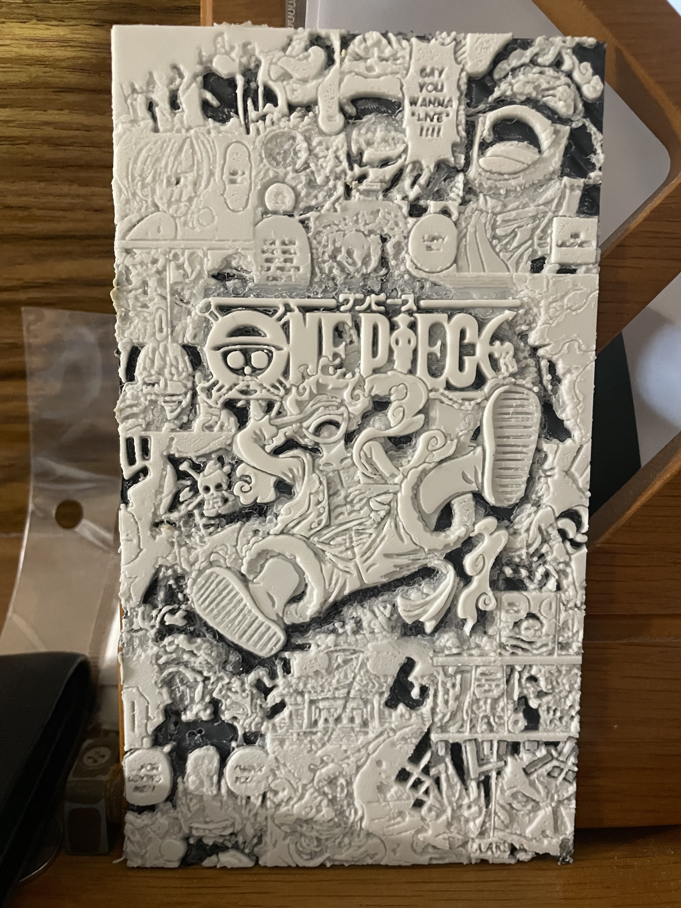
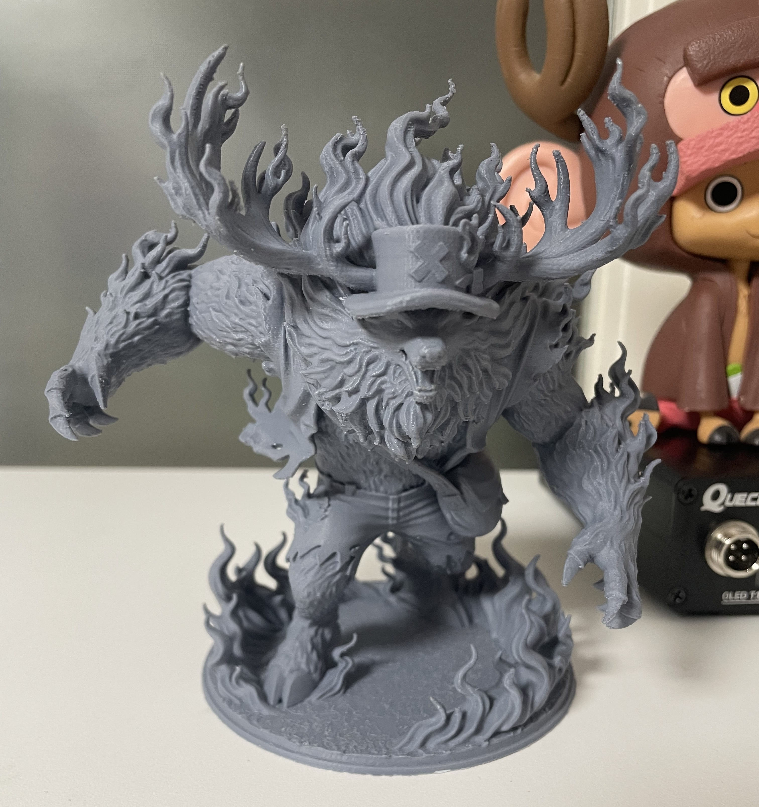
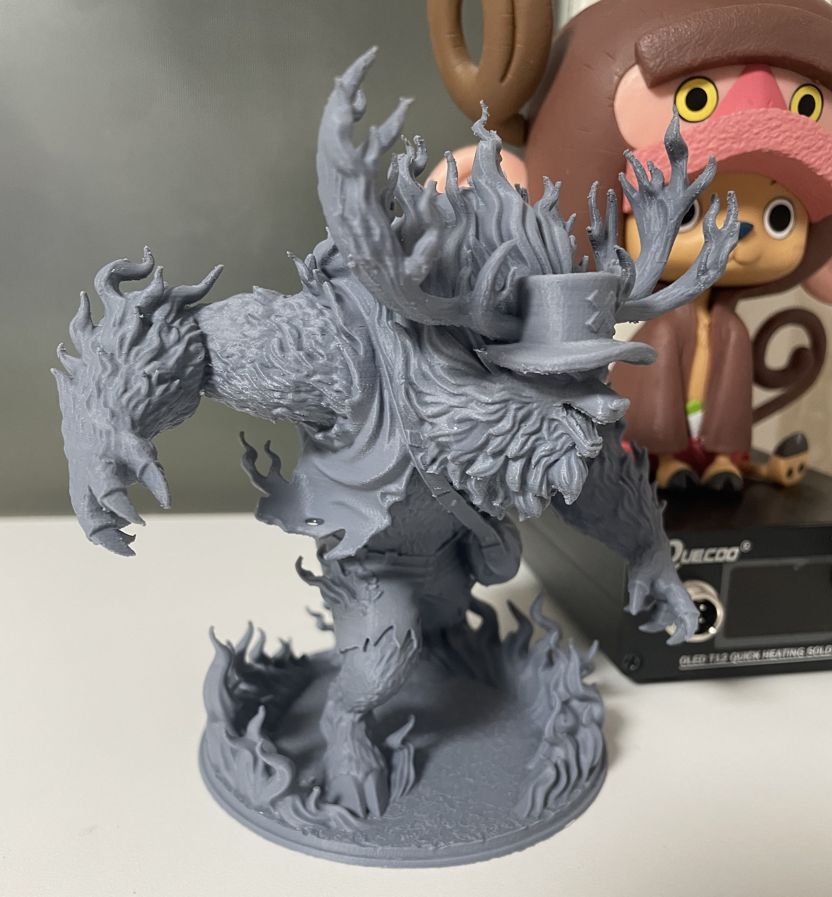

전에 kromacut으로 시도했었던 이미지 출력을 이번에는 유료 프로그램인 hueforge로 이미 만들어져 있던 모델을 출력해보았다. 

<figcaption>전보다 훨씬 나은듯</figcaption>

훨씬 나은 것 같다. 선 구분이 명확하고, 입체감도 생겼다. 확실히 무료와 유료 프로그램은 큰 차이가 있는건가... 

하지만 아직 아쉬운 점들이 존재하긴 한다. 세부적인 선들은 아직 무너지는 것 같다. 지금은 pa캘리랑 온도 캘리 했으니 지금 출력하면 더 잘 될듯? 그래도 내가 원하는 이미지를 3d화 하려면 프로그램은 사야되니까 아직은 계획에 없긴 하다. 이미지 출력은 여기까지 해보려고 한다. 

이거 외에 또 0.2노즐로 쵸파 몬스터 포인트 피규어를 출력해봤다. 이게 내가 했던 출력물중에 디테일은 제일 좋은 것 같다.

makerworld에서 다른 사람이 만들어둔 모델 출력했는데 0.2노즐이라 그런지 확실히 퀄리티가 좋다. 장정 48시간에 걸친 출력과 서포터 제거와 후가공에 약간 애먹었지만 그래도 이 정도면 굉장히 만족한다. 

아마 3d 프린터 가지고 해볼건 2학기 종강하고 할로우나이트 출력해서 도색하는거랑 이전에 미뤄뒀던 서씨 도색도 마저 해볼 것 같다.